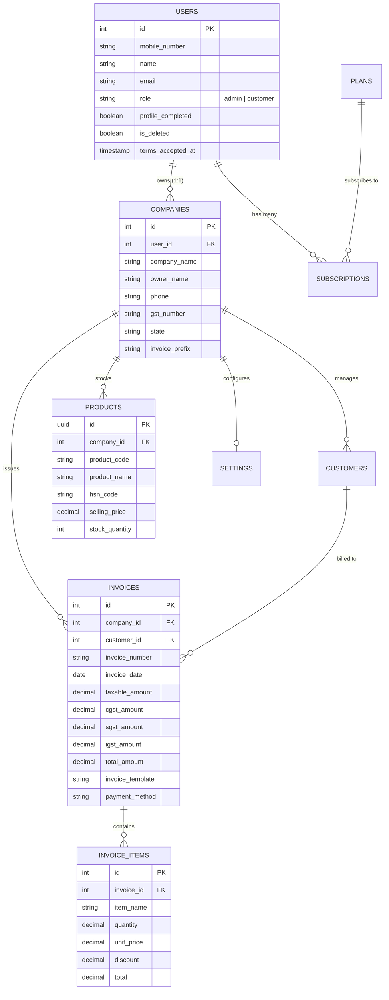

# 📘 Billing Pro (Billing Simply) - Comprehensive Architecture & Future Roadmap

> **System Version:** 1.0.0 Enterprise Ready  
> **Repository:** `dhamugreenleaf/Billing-pro`  
> **Last Updated:** September 2026  
> **Target Audience:** Core Developers, Solution Architects, Product Managers, and DevOps Engineers.

---

## 📑 Table of Contents
1. [Executive Summary](#1-executive-summary)
2. [Complete System Architecture & Directory Layout](#2-complete-system-architecture--directory-layout)
3. [Technology Stack Breakdown](#3-technology-stack-breakdown)
4. [Backend Deep Dive: Layered Architecture & Modules](#4-backend-deep-dive-layered-architecture--modules)
5. [Frontend Deep Dive: React Architecture, Layouts & Templates](#5-frontend-deep-dive-react-architecture-layouts--templates)
6. [Database Models, Schema & Entity Relationships](#6-database-models-schema--entity-relationships)
7. [Authentication, Security & MSG91 OTP Engine](#7-authentication-security--msg91-otp-engine)
8. [Billing & GST Tax Engine (Calculations, States & Formats)](#8-billing--gst-tax-engine-calculations-states--formats)
9. [Subscription, Tiered Quotas & Razorpay Gateway](#9-subscription-tiered-quotas--razorpay-gateway)
10. [Known Issues & Technical Debt (Audit & Fixes)](#10-known-issues--technical-debt-audit--fixes)
11. [Strategic Future Roadmap & Implementation Blueprints](#11-strategic-future-roadmap--implementation-blueprints)
12. [Step-by-Step Action Plan: Applying & Fixing](#12-step-by-step-action-plan-applying--fixing)

---

## 1. Executive Summary

**Billing Pro (Billing Simply)** is a modern, full-stack multi-tenant cloud-native invoicing and enterprise billing platform tailored for small to medium businesses (SMBs), retail stores, wholesalers, agencies, and service providers operating within India.

### Core Value Proposition
- **Frictionless Mobile-First Onboarding**: Passwordless authentication via MSG91 Secure OTP widget with automated SMS fallback and invisible captcha spam prevention.
- **Strict Indian GST Compliance**: Automatic computation of Intra-state (`CGST` + `SGST`) vs Inter-state (`IGST`) taxation based on company registered state and invoice Place of Supply (POS).
- **10 Modular Invoice Formats**: From standard B2C bills to Tally ERP-compliant prints, Retail POS 58mm/80mm thermal receipts, Wholesale B2B sheets, and Service Tax Invoices.
- **SaaS Monetization Engine**: Integrated tiered subscription tiers (`Free`, `Basic`, `Pro`) enforced at the API layer with Razorpay payment processing.
- **Comprehensive Admin Governance**: Super-admin portal allowing user management, subscription overrides, global GST configuration, and template feature gating.

---

## 2. Complete System Architecture & Directory Layout

The application utilizes a decoupled client-server architecture organized as a clean monorepo:

```
billing-simply/
├── backend/                  # Node.js + Express + Sequelize Backend
│   ├── server.js             # API entrypoint, CORS configuration & DB bootstrap
│   ├── package.json          # Backend dependencies (Express, Sequelize, PG, Razorpay, Zod)
│   ├── fix-production-db.js  # Utility script for production database indexing
│   └── src/
│       ├── config/           # Database connection (PostgreSQL) & Razorpay instance
│       ├── middleware/       # JWT Auth, Zod Validation, Plan Access Limiter, Global Error Handler
│       ├── models/           # Sequelize model registry, DB synchronization & seeds
│       ├── modules/          # Domain-Driven Modules (Layered: Route -> Controller -> Service -> Repo)
│       │   ├── admin/        # Super-admin control panel, statistics, global toggles
│       │   ├── auth/         # MSG91 OTP verification, JWT generation, user lifecycle
│       │   ├── company/      # Multi-tenant business profiles, branding & GSTIN
│       │   ├── customer/     # Customer directory, address book & purchase history
│       │   ├── invoice/      # Invoice creation, itemization, numbering & calculations
│       │   ├── product/      # Product catalog, HSN/SAC codes, barcode, pricing & inventory
│       │   ├── reports/      # Sales analytics, tax summaries, daily/monthly aggregations
│       │   ├── settings/     # Company-level billing preferences and invoice defaults
│       │   └── subscription/ # Subscription plans, user subscriptions & Razorpay checkout
│       └── utils/            # GST calculators, number-to-words, formatters, response helpers
│
├── frontend/                 # React 19 + Vite Frontend SPA
│   ├── index.html            # PWA manifest tags, Google fonts, MSG91 CDN script
│   ├── vite.config.js        # Vite build and dev server config
│   ├── package.json          # React 19, Redux Toolkit, React Router v7, Recharts, Lucide
│   └── src/
│       ├── main.jsx          # Redux provider, root DOM rendering
│       ├── App.jsx           # Client-side routing, protected routes, role-based guards
│       ├── components/       # Atomic UI components (Button, Input, Modal, PWA prompt)
│       ├── layouts/          # MainLayout, AdminLayout, AuthLayout, PublicLayout
│       ├── redux/            # Redux Toolkit store & auth slice
│       ├── styles/           # Vanilla CSS Design System (variables, responsive, toast, global)
│       ├── utils/            # Axios API client, currency formatters, number-to-words, SEO hooks
│       └── modules/          # Frontend Feature Modules
│           ├── admin/        # Admin dashboard, companies, customers, plans, formats, reports
│           ├── auth/         # Login (MSG91 OTP), Test login, Terms acceptance
│           ├── company/      # First-time Company onboarding wizard & profile edit
│           ├── customer/     # Customer directory management
│           ├── invoice/      # Invoice generator form, history table, and live preview
│           │   └── templates/# 10 Invoice rendering layouts (Tally, Retail, Modern, etc.)
│           ├── product/      # Inventory & product catalog UI (modal, search, HSN filter)
│           ├── public/       # Public SEO landing pages (GST software, invoice templates)
│           ├── reports/      # Interactive sales charts (Recharts) and export buttons
│           ├── settings/     # Business preferences, GST rate toggles, legal policies
│           └── subscription/ # Customer pricing table & Razorpay checkout flow
│
├── msg91_otp.md              # Technical integration guide for MSG91 SDK
└── PROJECT_DOCUMENTATION_AND_ROADMAP.md # (This master reference document)
```

---

## 3. Technology Stack Breakdown

### Backend Stack
| Technology | Version | Purpose |
| :--- | :--- | :--- |
| **Node.js** | >= 18.0.0 (ESM) | Native ECMAScript Modules (`import/export`) |
| **Express.js** | `^4.18.2` | REST API routing and middleware pipeline |
| **PostgreSQL** | `^8.11.3` (pg) | Primary relational transactional database |
| **Sequelize** | `^6.32.1` | Object-Relational Mapping (ORM) with schema sync |
| **Zod** | `^3.22.2` | Runtime schema validation for request payloads |
| **JSONWebToken** | `^9.0.1` | Stateless authentication tokens (HMAC-SHA256) |
| **BcryptJS** | `^2.4.3` | Password hashing for test/admin accounts |
| **Razorpay SDK** | `^2.9.8` | Order creation and cryptographic webhook/signature verification |
| **Cors & Dotenv** | Standard | Cross-origin resource sharing & environment variables |

### Frontend Stack
| Technology | Version | Purpose |
| :--- | :--- | :--- |
| **React** | `^19.2.8` | Modern declarative component architecture |
| **Vite** | `^8.2.0` | Ultra-fast HMR and optimized production bundling |
| **React Router** | `^7.18.2` | Client-side routing with nested layouts and navigation guards |
| **Redux Toolkit** | `^2.12.0` | Global state management for authentication session |
| **Axios** | `^1.19.0` | HTTP client with bearer token interceptors & unified error parsing |
| **Lucide React** | `^1.31.0` | Modern, cohesive iconography |
| **Recharts** | `^3.10.1` | Business analytics graphs (Bar charts, Area charts) |
| **React Hot Toast** | `^2.6.0` | Non-intrusive UI feedback alerts |
| **Vanilla CSS** | Pure CSS3 | Custom CSS variable design system (`--color-primary`, `--font-main`) |

---

## 4. Backend Deep Dive: Layered Architecture & Modules

The backend adheres strictly to the **Controller-Service-Repository (CSR)** architectural design pattern:

```
Request (HTTP)
   │
   ▼
[Route] ──> [auth.middleware] ──> [validate.middleware (Zod)]
                                             │
                                             ▼
                                     [Controller]
                                             │
                                             ▼
                                      [Service] (Business Logic & Calculations)
                                             │
                                             ▼
                                    [Repository] (Database Queries)
                                             │
                                             ▼
                                    [Sequelize Models] ──> PostgreSQL
```

### Domain Modules Breakdown

1. **`auth` Module**:
   - Manages mobile phone login via MSG91 widget token verification.
   - Idempotency & short-lived verification cache (`tokenCache` Map with 2-min TTL) prevents race conditions and double-login calls.
   - Automatically handles role segregation: `customer` vs `admin`.
   - Issues signed JWT containing `id`, `company_id`, and `role`.

2. **`company` Module**:
   - Represents the billing entity (tenant).
   - Stores legal entity details: Company Name, GSTIN, Owner, Contact Phone, Registered Address, State, Pincode, and Logo.
   - Enforces unique invoice serial numbers scoped to each company via `invoice_prefix` (e.g., `INV`, `GLA`, `BILL`).

3. **`invoice` Module**:
   - Handles the core billing engine.
   - Computes subtotal, discounts, taxable value, CGST/SGST/IGST, and rounded gross total.
   - Handles multi-line items (`InvoiceItem` table) with item-level taxes or flat lump-sum billings.
   - Formats unique incrementing invoice codes (`INV-000001`, `INV-000002`).
   - Supports switching templates retroactively for any generated invoice.

4. **`customer` Module**:
   - Scoped strictly to `company_id`.
   - Auto-upserts customers during invoice generation or via direct customer directory creation.
   - Keeps billing and shipping addresses for recurring autofill.

5. **`product` Module**:
   - Maintains inventory catalog: `product_code`, `product_name`, `category`, `brand`, `hsn_code`, `barcode`, `purchase_price`, `selling_price`, `gst_percentage`, and `stock_quantity`.
   - Enables fast item lookups during bill creation.

6. **`subscription` Module**:
   - Enforces bill limits per plan:
     - **Free Plan**: 10 bills / month
     - **Basic Plan**: 50 bills / month (₹1/mo sandbox / ₹99/mo prod)
     - **Pro Plan**: 500 bills / month (₹10/mo sandbox / ₹499/mo prod)
     - **Enterprise Plan**: Unlimited bills
   - Implements Razorpay order generation (`POST /api/subscription/create-order`) and signature validation (`POST /api/subscription/verify-payment`).

7. **`admin` Module**:
   - Provides global visibility for the SaaS owner.
   - Super-admin endpoints to inspect all tenant companies, all invoices, system-wide revenue, and registered phone numbers.
   - Ability to toggle specific invoice templates globally or restrict them to paid tiers.

8. **`reports` Module**:
   - Aggregates company revenue, collected tax, discount totals, and payment methods (Cash, UPI, Card, Net Banking).
   - Generates historical data for monthly trend analysis.

---

## 5. Frontend Deep Dive: React Architecture, Layouts & Templates

### Route & Layout Topology
The frontend uses nested routing via `react-router-dom`:
- **`AuthLayout`**: Minimalist centered shell for `/login`, `/admin-login`, and `/test-login`.
- **`MainLayout`**: Application dashboard layout containing top navigation bar, quick billing action, user status, and responsive sidebar.
- **`AdminLayout`**: Dedicated administration portal with system-wide analytics, customer moderation, template toggles, and plan configs.
- **`PublicLayout`**: Optimized SEO landing pages (`/gst-billing-software`, `/invoice-formats`, `/retail-billing-software`) with schema metadata for organic search discovery.

### The 10 Invoice Layout Templates
Invoices can be rendered into 10 distinct visual formats to serve different business verticals:

| Template Name | Identifier | Target Business Vertical | Key Visual Characteristics |
| :--- | :--- | :--- | :--- |
| **Basic Format** | `standard` | Small shops, general trades | Clean single-page table, essential totals, minimal styling |
| **Tally Format** | `tally` | Accounting firms, CA clients | Authentic Tally ERP font and grid borders, ledger-style header |
| **Classic Invoice** | `classic` | Traditional B2B suppliers | Traditional corporate layout, bordered boxes, bank details box |
| **Modern Invoice** | `modern` | Digital agencies, startups | Elegant typography, gradient accent header, badge pills |
| **Wholesale / B2B**| `wholesale`| Distributors, wholesalers | HSN summary table, batch numbers, reverse charge & delivery notes |
| **Retail POS Bill** | `retail` | Supermarkets, clothing stores| 58mm / 80mm thermal receipt format, condensed line items |
| **Advanced Tax** | `advanced` | Large manufacturers, exporters | Comprehensive GST break-up table (Taxable, CGST, SGST, IGST columns) |
| **Service Invoice** | `service` | Consultants, freelancers | Milestone / hourly rate descriptions, SAC codes, terms clause |
| **Proforma Invoice**| `proforma` | Quotations & estimates | Prominent "PROFORMA / ESTIMATE" watermark, bank advance instructions |
| **Premium Invoice** | `premium` | Luxury retailers, boutiques | Minimalist dark accents, currency in words, stylized signature line |

---

## 6. Database Models, Schema & Entity Relationships



---

## 7. Authentication, Security & MSG91 OTP Engine

### Authentication Flow Sequence
```
[User Phone Input] 
      │
      ▼
[MSG91 Web SDK] ──> Generates OTP & delivers SMS ──> [User inputs 4/6 digit OTP]
                                                               │
                                                               ▼
                                              [MSG91 returns Access-Token]
                                                               │
                                                               ▼
                                              [POST /api/auth/verify-msg91]
                                                               │
                                                               ▼
                                         [Node.js Backend calls MSG91 API]
                                         (GET /api/v5/widget/verifyAccessToken)
                                                               │
                                         ┌─────────────────────┴─────────────────────┐
                                         ▼                                           ▼
                                   [Token Valid]                               [Token Invalid]
                                         │                                           │
                           [Find or Create User Record]                        [400 Rejection]
                                         │
                           [Issue App JWT Bearer Token]
```

### Security Safeguards Implemented
- **Secret Credentials Isolation**: `MSG91_AUTH_KEY` and `RAZORPAY_KEY_SECRET` never leave the Node.js backend environment.
- **Idempotency Cache**: Prevents double-invocation or race condition failures when multiple client clicks occur simultaneously.
- **Role-Based Middlewares**: `protect` middleware decodes JWT and validates that inactive/deleted users are blocked immediately.
- **Zod Data Sanitization**: Prevents SQL injection and malformed inputs at the controller threshold.

---

## 8. Billing & GST Tax Engine (Calculations, States & Formats)

### Tax Engine Formula
1. **Intra-State Transaction** (`company.state.toLowerCase() === invoice.place_of_supply.toLowerCase()`):
   $$\text{CGST Rate} = \frac{\text{GST Rate}}{2}, \quad \text{SGST Rate} = \frac{\text{GST Rate}}{2}$$
   $$\text{CGST Amount} = \text{Taxable Value} \times \text{CGST Rate}$$
   $$\text{SGST Amount} = \text{Taxable Value} \times \text{SGST Rate}$$
   $$\text{IGST Amount} = 0$$

2. **Inter-State Transaction** (`company.state.toLowerCase() !== invoice.place_of_supply.toLowerCase()`):
   $$\text{IGST Rate} = \text{GST Rate}, \quad \text{IGST Amount} = \text{Taxable Value} \times \text{IGST Rate}$$
   $$\text{CGST Amount} = 0, \quad \text{SGST Amount} = 0$$

3. **Tax Inclusive vs Exclusive**:
   - **Exclusive (Default)**:
     $$\text{Tax Amount} = \frac{\text{Taxable Amount} \times \text{GST Rate}}{100}$$
     $$\text{Gross Total} = \text{Taxable Amount} + \text{Tax Amount}$$
   - **Inclusive**:
     $$\text{Taxable Value} = \frac{\text{Total Paid}}{1 + \left(\frac{\text{GST Rate}}{100}\right)}$$
     $$\text{Tax Amount} = \text{Total Paid} - \text{Taxable Value}$$

---

## 9. Subscription, Tiered Quotas & Razorpay Gateway

The application enforces business monetization directly at the service layer:
```javascript
const planLimits = {
  'Free': 10,       // 10 invoices per calendar month
  'Basic': 50,      // 50 invoices per calendar month
  'Pro': 500,       // 500 invoices per calendar month
  'Enterprise': Infinity
};
```
Before `Invoice.create` is invoked, `countInvoicesForCurrentMonth(company.id)` queries the database. If the quota is exceeded, HTTP 403 Forbidden is returned with instructions to upgrade.

---

## 10. Known Issues & Technical Debt (Audit & Fixes)

During the codebase audit, the following key items were identified for enhancement and stabilization:

| Area | Current State | Potential Risk | Recommended Resolution |
| :--- | :--- | :--- | :--- |
| **Inventory Sync** | Products exist in DB, but `Invoice.create` does NOT decrement `Product.stock_quantity`. | Stock numbers in catalog remain static despite sales. | Add automatic stock decrement in `invoice.service.js` with rollback on cancellation. |
| **DB Sync in Production** | `server.js` executes `sequelize.sync({ alter: true })` on every server boot. | Schema locks, slow startup, and accidental table alteration under load. | Switch to standard versioned migrations using Sequelize CLI or Umzug. |
| **Payment Webhooks** | Razorpay flow verifies payment on frontend redirect. | Network drop between Razorpay popup and frontend callback leaves plan un-activated. | Implement server-side Razorpay webhook listener at `/api/subscription/webhook`. |
| **Invoice Number Concurrency** | Invoice numbers calculated via `countInvoicesByCompany(company.id) + 1`. | Simultaneous invoice creation could trigger identical invoice numbers. | Use PostgreSQL sequence or atomic database transaction locking. |
| **Print Performance** | Relies on browser CSS `@media print`. | Varied margins across different operating systems / printers. | Add server-side headless Chrome (Puppeteer) PDF generation download option. |

---

## 11. Strategic Future Roadmap & Implementation Blueprints

### 🚀 Phase 1: High-Priority Enhancements (Immediate Impact)

#### 1. Automatic Inventory & Stock Decrement
- **Problem**: When creating invoices with line items, store inventory counts are not updated.
- **Implementation Blueprint**:
  - When saving `InvoiceItem`, match `item_name` or `product_code` against `Product`.
  - In a Sequelize managed transaction, execute:
    ```javascript
    await Product.decrement('stock_quantity', {
      by: item.quantity,
      where: { id: item.product_id, company_id },
      transaction
    });
    ```
  - Display "Low Stock Warning" (when `stock_quantity <= minimum_stock`) in the Invoice Form.

#### 2. Native Direct Thermal POS Hardware Printing (58mm / 80mm)
- **Problem**: Retail cashiers must navigate the system print dialog for every transaction.
- **Implementation Blueprint**:
  - Implement WebUSB and Web Bluetooth API integration to connect directly to ESC/POS thermal printers.
  - Add a "1-Click Direct Print" button in `RetailInvoice.jsx` that bypasses the OS print preview.

#### 3. Razorpay Server-Side Webhook Integration
- **Problem**: If a user's browser closes after payment, subscription state remains un-updated.
- **Implementation Blueprint**:
  - Expose `POST /api/subscription/webhook`.
  - Use `crypto.createHmac('sha256', secret)` to verify `X-Razorpay-Signature`.
  - On `order.paid` or `subscription.charged`, find `Subscription` and activate immediately.

---

### 🚀 Phase 2: Medium-Term Growth & Scale Features

#### 4. Indian Government E-Invoicing & E-Way Bill Integration
- **Capability**: Mandatory for businesses with turnover > ₹5 Cr.
- **Implementation Blueprint**:
  - Connect with licensed GSP (GST Suvidha Provider) APIs (e.g., ClearTax, MasterGST).
  - Add "Generate IRN" button on invoice view to generate official 64-character IRN and signed QR code.
  - Automatically render the signed QR code on `AdvancedInvoice.jsx` and `WholesaleInvoice.jsx`.

#### 5. WhatsApp Automated PDF Delivery (WhatsApp Cloud API)
- **Capability**: Currently only deep-links to `https://wa.me/` with plain text.
- **Implementation Blueprint**:
  - Integrate Meta WhatsApp Business Cloud API.
  - Send templated messages with an attached secure PDF download URL upon bill creation.
  - Allow customers to download invoices directly inside WhatsApp.

#### 6. Multi-User Role-Based Access Control (Staff & Cashiers)
- **Capability**: Multiple employees under one tenant company.
- **Implementation Blueprint**:
  - Introduce `Staff` model linking `user_id`, `company_id`, and `role` (`owner`, `manager`, `cashier`, `accountant`).
  - Permissions: Cashiers can only generate bills (cannot view total monthly turnover or delete invoices).

#### 7. Dynamic UPI Dynamic QR Code on Invoices
- **Capability**: Faster in-store and B2B payment collection.
- **Implementation Blueprint**:
  - Generate Bharat QR / UPI Intent QR Code dynamically on the printed invoice:
    ```
    upi://pay?pa=company_upi_id@bank&pn=Company_Name&am=TOTAL_AMOUNT&tr=INVOICE_NUMBER&cu=INR
    ```
  - Customer scans the QR code directly off the printed paper or screen to pay instantly.

---

### 🚀 Phase 3: Enterprise & Platform Capabilities

#### 8. Offline PWA Synchronization (Offline-First POS)
- Store catalog and offline invoices locally using `Dexie.js` (IndexedDB).
- When internet drops, cashier continues billing seamlessly.
- Sync engine pushes pending invoices to the server as soon as connection is restored.

#### 9. Tally & Zoho Books Two-Way XML Sync
- Implement an XML export adhering to Tally Prime XML Schema format (`ENVELOPE/BODY/DATA/TALLYMESSAGE/VOUCHER`).
- Accountants can drag-and-drop the exported file straight into Tally without manual data entry.

#### 10. Automated Recurring Invoicing & Retainers
- Set billing frequency: Weekly, Monthly, Quarterly, Annually.
- Background CRON worker generates recurring invoices automatically and emails the PDF to the client.

---

## 12. Step-by-Step Action Plan: Applying & Fixing

To upgrade the application with these strategic improvements, follow this phased execution plan:

### Step 1: Inventory Deduction Fix
1. Open [invoice.service.js](file:///d:/billing-simply/backend/src/modules/invoice/services/invoice.service.js).
2. Wrap `createInvoice` in a Sequelize database transaction:
   ```javascript
   const result = await sequelize.transaction(async (t) => {
     const invoice = await invoiceRepo.createInvoice(newInvoiceData, itemsToSave, { transaction: t });
     for (const item of itemsToSave) {
       if (item.product_id) {
         await Product.decrement('stock_quantity', { by: item.quantity, where: { id: item.product_id, company_id: company.id }, transaction: t });
       }
     }
     return invoice;
   });
   ```
3. Update [InvoiceForm.jsx](file:///d:/billing-simply/frontend/src/modules/invoice/InvoiceForm.jsx) to link selected dropdown items to their respective `product_id`.

### Step 2: Add Dynamic UPI Payment QR Code
1. Install `qrcode.react` in `frontend/`.
2. In [RetailInvoice.jsx](file:///d:/billing-simply/frontend/src/modules/invoice/templates/RetailInvoice.jsx) and [ModernInvoice.jsx](file:///d:/billing-simply/frontend/src/modules/invoice/templates/ModernInvoice.jsx), render:
   ```jsx
   <QRCodeSVG value={`upi://pay?pa=${company.upi_id || ''}&pn=${encodeURIComponent(company.company_name)}&am=${invoice.total_amount}&tn=${invoice.invoice_number}&cu=INR`} size={100} />
   ```

### Step 3: Implement Webhook Listener for Razorpay
1. Open [subscription.routes.js](file:///d:/billing-simply/backend/src/modules/subscription/subscription.routes.js).
2. Register `router.post('/webhook', express.raw({type: 'application/json'}), subscriptionController.handleWebhook);`.
3. In `subscription.service.js`, verify `crypto.createHmac('sha256', process.env.RAZORPAY_WEBHOOK_SECRET)`.
4. Update `Subscription.status = 'active'` when event `payment.captured` fires.

### Step 4: Production Safe Migrations
1. In [server.js](file:///d:/billing-simply/backend/server.js), remove `syncDatabase()` alter loops from production mode.
2. Initialize Sequelize CLI migrations for all future database schema modifications.

---

*This document serves as the authoritative blueprint for Billing Pro. Refer to individual module source directories for granular implementation details.*
